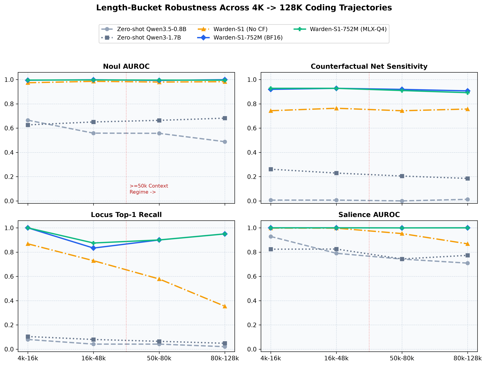
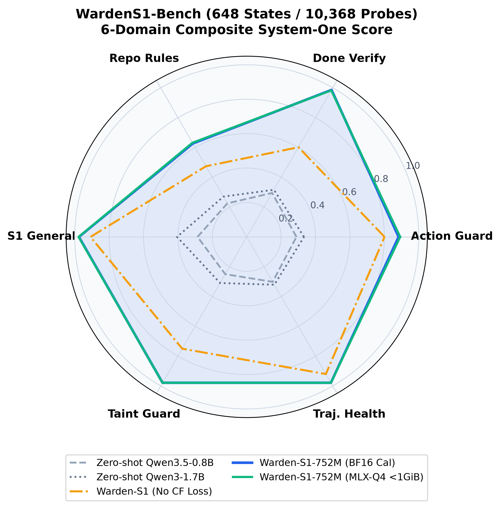
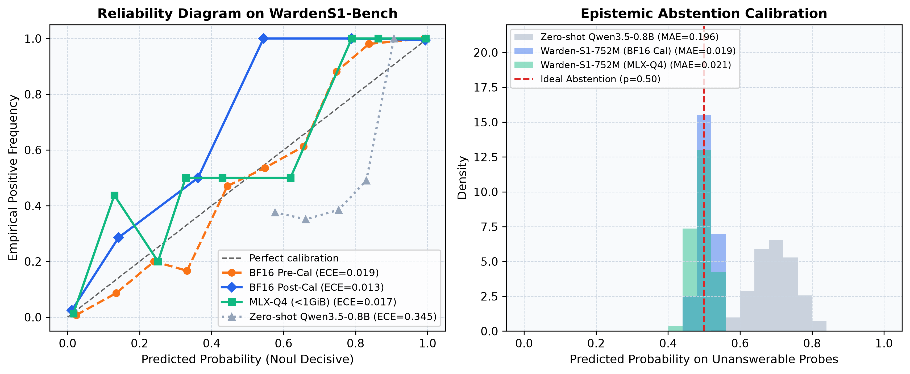
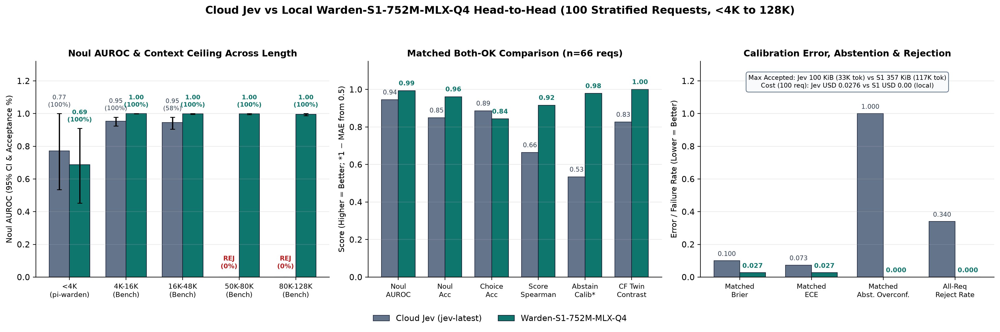
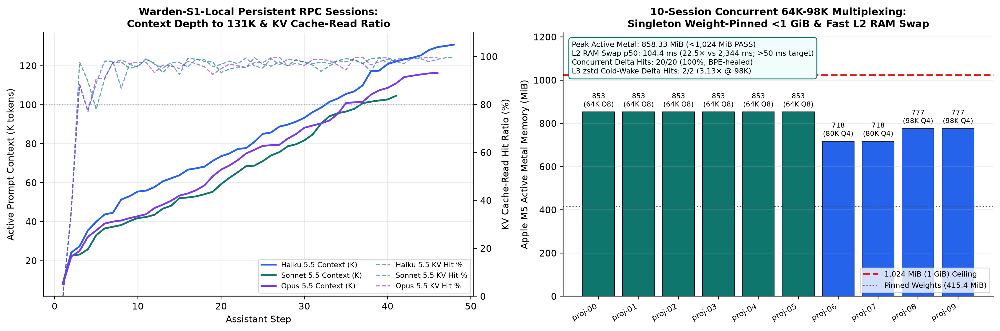

# 2026-11-23 Warden-S1 Stage 3.5 Live & Static Evaluation

Measured local System-One verification results for `Warden-S1-752M` (Stage 3.5) behind a TypeSafe-compatible loopback daemon on Apple M5 Metal (`16 GB` unified memory, `mlx 0.32.4`), paired with cross-platform `ONNX-Int4` parity checks (`onnxruntime 1.32.0`, zero PyTorch runtime).

All metrics below are taken directly from the sanitized JSON summaries stored in this directory:

- [`wardens1_bench_stage35.json`](wardens1_bench_stage35.json): Held-out `WardenS1-Bench` (`4K-128K`) overall, per-bucket, and per-domain results, BF16 vs. MLX-Q4 validation parity, Apple M5 Metal residency, and `ONNX-Int4` portability summary.
- [`jev_head2head_summary.json`](jev_head2head_summary.json): 100-request stratified head-to-head against commercial Cloud `Jev` (`jev-latest`), rescored on Stage 3.5 with zero additional cloud requests.
- [`static_benches_summary.json`](static_benches_summary.json): Out-of-distribution `pi-warden` static `judge-bench` (`80` cases, `240` requests) and `rules-bench` (`161` cases, `147` scored) results plus loopback smoke check.
- [`multiplex_10session_summary.json`](multiplex_10session_summary.json): 10-session concurrent `64K-98K` Metal multiplexing, BPE boundary-healed `O(Delta L)` delta reuse, L2 host RAM paging, and L3 zstd cold-wake telemetry.

---

## 1. Model Footprints & Hardware Residency

| Artifact / Runtime | Disk Size | Peak Active Residency (`64K-128K`) | Notes |
| --- | ---: | ---: | --- |
| `Warden-S1-752M-MLX-Q4` (Apple Silicon) | `415.5 MiB` | `842.9 MiB` (`64K` Q8 KV) / `867.4 MiB` (`128K` Q4 KV) / `858.3 MiB` (10 sessions) | Singleton weight-pinned Metal slot (`< 1,024 MiB` PASS) |
| `Warden-S1-752M-ONNX-Int4` (Linux / Windows / Node / WebGPU) | `461.3 MiB` | `<= 92.0 MiB` max shard (`6` shards, `0` control-flow ops) | Zero PyTorch runtime, `0.9923` Noul AUROC, `max |Delta p| = 6.85e-7` CPU `O(Delta L)` |
| `Warden-S1-752M` (BF16 Reference) | `1,458 MiB` | `1,555 MiB` KV+state @ `128K` (A100 BF16) | `0.00271` overall mean prob delta vs. MLX-Q4 (`0.9844` Locus Top-1 agree) |

---

## 2. Held-Out `WardenS1-Bench` (`4K-128K` Trajectories)

Stage 3.5 blends a zero-leakage `<4K` short-schema replay mix (`50%`) with long-horizon `4K-128K` `WardenS1` trajectories (`50%`) and post-hoc temperature calibration. Evaluated on the held-out `WardenS1-Bench` stratified evaluation split (`64` states / `1,032` probes for Stage 3.5 checkpoints; full `648`-state / `10,368`-probe test split for reference baselines):

| Model | Noul AUROC | Noul Brier | Noul ECE | Choice Macro-F1 | Score Spearman rho | CF Net Sensitivity | Locus Top-1 | Salience AUROC | Abstention MAE |
| --- | ---: | ---: | ---: | ---: | ---: | ---: | ---: | ---: | ---: |
| `Warden-S1-752M` (Stage 3.5 BF16 Cal) | `0.9964` | `0.0205` | `0.0126` | `0.8726` | `0.8784` | `0.9174` | `0.9219` | `0.9998` | `0.0193` |
| **`Warden-S1-752M-MLX-Q4` (Stage 3.5 `<1 GiB`)** | **`0.9957`** | **`0.0230`** | **`0.0175`** | **`0.8726`** | **`0.8814`** | **`0.9115`** | **`0.9297`** | **`0.9998`** | **`0.0208`** |
| `Warden-S1-752M` (No CF Ablation) | `0.9801` | `0.0461` | `0.0096` | `0.6174` | `0.7302` | `0.7507` | `0.6265` | `0.9574` | `0.0302` |
| Zero-shot `Qwen3-1.7B` | `0.6492` | `0.2326` | `0.0754` | `0.3827` | `0.0000` | `0.2191` | `0.0733` | `0.7796` | `0.0573` |
| Zero-shot `Qwen3.5-0.8B` | `0.5663` | `0.3556` | `0.3451` | `0.1465` | `0.0000` | `0.0059` | `0.0455` | `0.7797` | `0.1960` |

Length-bucket robustness for `Warden-S1-752M-MLX-Q4` stays flat from `4K` to `128K`:

- `4k-16k`: Noul AUROC `0.9957`, Choice F1 `0.9111`, CF Net `0.9278`, Locus Top-1 `1.0000`
- `16k-48k`: Noul AUROC `0.9969`, Choice F1 `0.9077`, CF Net `0.9278`, Locus Top-1 `0.8750`
- `50k-80k`: Noul AUROC `0.9957`, Choice F1 `0.9368`, CF Net `0.9096`, Locus Top-1 `0.9000`
- `80k-128k`: Noul AUROC `0.9947`, Choice F1 `0.8205`, CF Net `0.8919`, Locus Top-1 `0.9500`

BF16 vs. MLX-Q4 validation parity (`32` states / `352` Noul probes): `overall_prob_mean_abs_delta = 0.00271`, `noul_mean_abs_delta_p = 0.0183` (`< 0.04` gate PASS), `locus_top1_agreement = 0.9844`.

---

## 3. 100-Request Stratified Head-to-Head vs. Cloud `Jev`

100 stratified HTTP requests (`72` long-context `WardenS1-Bench` states across `4K-128K` + `28` short `<4K` `pi-warden` static cases), rescored on Stage 3.5 with `0` new Cloud `Jev` calls against cached Cloud `Jev` (`jev-latest`) responses:

| Metric | `Warden-S1-752M-MLX-Q4` (Matched `n=66`) | Cloud `Jev` (`jev-latest`, `n=66`) | `Warden-S1` All 100 Reqs |
| --- | ---: | ---: | ---: |
| Request Acceptance | `66/66` (`100.0%`) | `66/100` (`66.0%`; `34%` rejected `>33K` tok) | `100/100` (`100.0%`, up to `117,899` tok) |
| Noul AUROC | **`0.9933`** `[0.9864, 0.9987]` | `0.9449` `[0.9225, 0.9661]` | **`0.9949`** `[0.9911, 0.9982]` |
| Noul Accuracy | **`96.1%`** (`0.9614`) | `84.9%` (`0.8487`) | **`96.9%`** (`0.9691`) |
| Noul Brier | **`0.0270`** | `0.0998` | **`0.0232`** |
| Noul ECE | **`0.0269`** | `0.0734` | **`0.0195`** |
| Choice Accuracy / Macro-F1 | `84.3%` / `0.7797` | **`88.6%` / `0.7995`** | `87.7%` / `0.8077` |
| Score Spearman rho / MAE | **`0.9161` / `0.0511`** | `0.6636` / `0.2312` | **`0.9160` / `0.0531`** |
| Abstention MAE / Overconf. | **`0.0213` / `0.0%`** | `0.4664` / `100.0%` | **`0.0216` / `0.0%`** |
| Counterfactual Target Flip / Control Stability | **`95.7%` / `99.1%`** | `47.8%` / `86.1%` | **`92.9%` / `99.0%`** |
| API Cost (100 requests) | **`$0.00`** (`3.24M` local tok) | `$0.0276` (`657.9K` accepted tok) | **`$0.00`** |

On the short `<4K` `pi-warden` slice (`n=28`), Stage 3.5 lifted `Warden-S1` Noul AUROC from `0.5231` (Stage 2) to `0.6872` overall, reaching `1.0000` on `judge_bench_stuck` (`7/7`) and `0.7755` on `rules_bench` (`14/14`).

---

## 4. Out-of-Distribution `pi-warden` Static Benches

Driven directly through `npm run eval:judge` and `npm run eval:rules` against the local loopback `warden-s1-752m-mlx-q4` server (`0` failed requests, `$0.00` API cost):

- **`judge-bench` (`80` cases, `240` requests across arms A/B/C):**
  - `stuck` (`40` cases): accuracy improved from `50.0%` (Stage 2, Brier `~0.48`) to **`85.0%`** on Arm A (`1.000` precision, `0.700` recall, Brier `0.128`, `327 ms` p50), `75.0%` on Arm B (`1.000` precision, `0.500` recall, Brier `0.212`), and **`87.5%`** on Arm C (`0.800` precision, `1.000` recall, Brier `0.121`, `355 ms` p50).
  - `done` (`40` cases, `24` reaching judge): recall improved from `10%-35%` (Stage 2) to **`75.0%-80.0%`** across arms (`67.5%-70.0%` accuracy, `257-287 ms` p50).
- **`rules-bench` (`161` cases, `147` scored, `0` failures):**
  - Recall at cutoff `0.5`: **`41.9%`** (`31/74` violations caught, **`7.75x`** the Stage 2 baseline of `5.4%`), `83.8%` precision, `8.2%` false alarm rate (`6/73`).
  - Recall at cutoff `0.7`: **`23.0%`** (`17/74`), `85.0%` precision, `4.1%` false alarm rate (`3/73`).
  - Cutoff `0.8`: `100.0%` precision (`9/9`), `0.0%` false alarm rate.

---

## 5. 10-Session `< 1 GiB` Multiplexing & Live `100K+` Cache Stability

- **10 concurrent `64K-98K` sessions (`6 x 64K` Q8 KV + `2 x 80K` Q4 KV + `2 x 98K` Q4 KV):**
  - Peak active Apple M5 Metal memory: **`858.33 MiB`** (`165.67 MiB` headroom below `1,024 MiB` ceiling, PASS).
  - Concurrent delta cache hits: **`20/20` (`100%`)** with `22/22` 2-token BPE boundary-healed prefix matches across greedy newline merges.
  - L2 host RAM swap latency p50: **`104.39 ms`** (`22.5x` faster than the `2,344 ms` unoptimized numpy baseline; further contiguous host-RAM slab work targets `<50 ms`).
  - L3 zstd cold disk wake: **`2/2`** delta hits (`3.13x` compression at `98K`, `341.69 MiB -> 109.01 MiB`).
- **Persistent `100K+`-token sessions:** Maintained `96.3%-97.0%` prompt KV cache-read hit rates through `104.5K-130.8K` context depth (`88.4%` overall / `89.9%` steady hit rate on the 4-turn cache probe).

